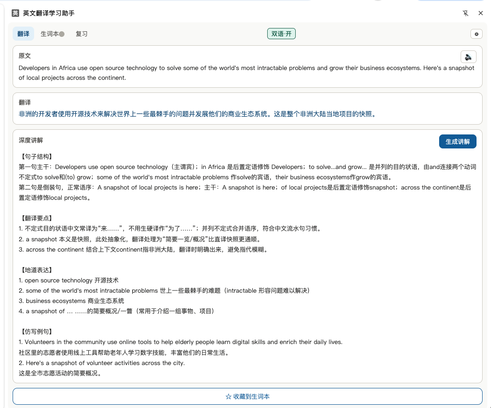
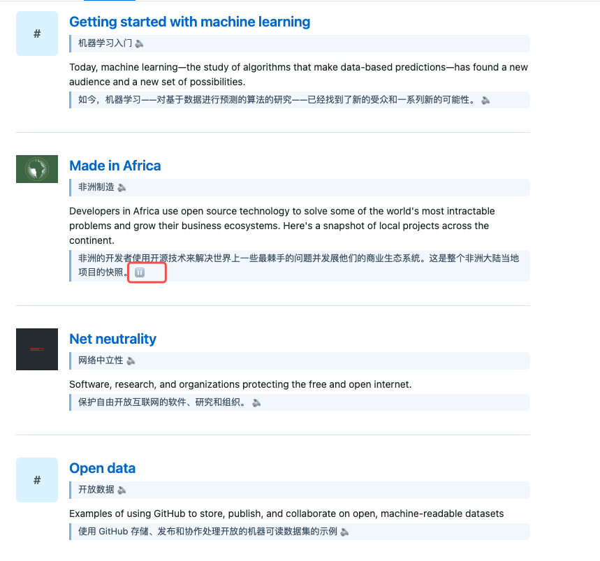
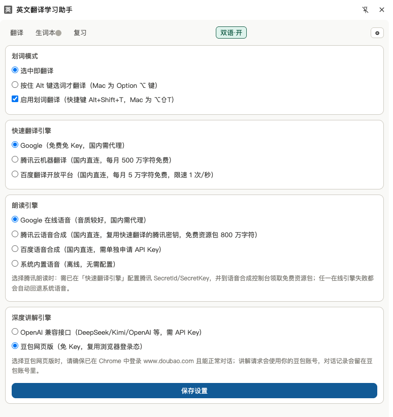
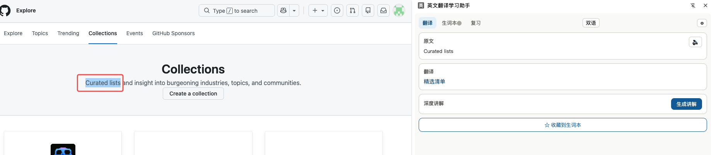
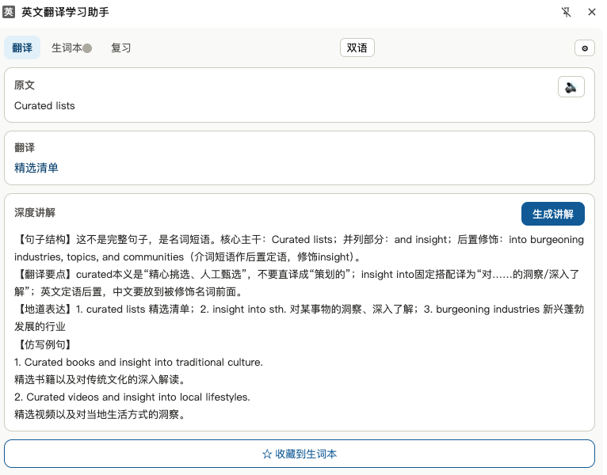
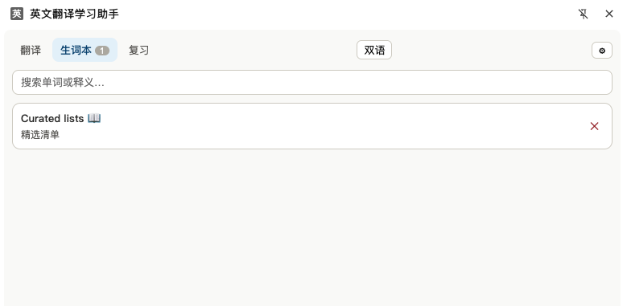

# Translate Learner — 英文翻译学习助手 | Chrome 划词翻译插件

[](https://www.google.com/chrome/)
[](https://developer.chrome.com/docs/extensions/develop/concepts/mv3-overview)
[](#license)

**Chrome 划词翻译 + AI 深度讲解 + 双语对照阅读 + 生词本复习**，一款「边读边学」的浏览器插件。

> **English**: Translate Learner is a Chrome extension for English learners — select-to-translate any text on the web, get AI-powered deep explanations (word roots, grammar, collocations, example sentences), read in bilingual side-by-side mode, and build your vocabulary with spaced-repetition flashcards.

**核心流程**：划词即译 → 侧边面板秒出翻译 → AI 深度讲解 → 一键收藏生词 → 卡片复习，并支持**双语对照沉浸式阅读**（原文与翻译同屏对照、逐段朗读）。

**关键词**：划词翻译 · 沉浸式翻译 · 双语对照 · 英语学习 · 生词本 · 艾宾浩斯复习 · AI 讲解 · Chrome Extension · Select to Translate · Bilingual Reading · Immersive Translation · Vocabulary Builder · DeepSeek · 豆包 · 腾讯云 · 百度翻译

<div align="center">
  
  
</div>

---

## ✨ 功能特性

| 功能 | 说明 |
|------|------|
| 🔍 划词翻译 | 选中英文自动触发（350ms 防抖），单词附带词典释义（词性 + 多义） |
| 🧠 AI 深度讲解 | 单词：词义辨析 / 词根词缀 / 常见搭配 / 例句；句子：结构分析 / 翻译要点 / 仿写 |
| 📖 双语对照阅读 | 网页段落下方插入中文翻译，边读原文边看译文，逐段可朗读 |
| 📚 生词本 | 一键收藏（含上下文与深度讲解），支持搜索、回看 |
| 🃏 卡片复习 | 翻转卡片 + 三档评分（不认识/模糊/认识），掌握度低的词优先出现 |
| 🔊 多引擎朗读 | Google / 腾讯云 / 百度 / 系统语音四选一，自动兜底回退 |
| ⚙️ 引擎可插拔 | 快译、朗读、讲解三层引擎均可自由切换，国内可全程直连免代理 |

## 📦 安装

1. 下载 / 克隆本仓库
2. 打开 Chrome，地址栏输入 `chrome://extensions/`
3. 右上角打开 **「开发者模式」** 开关
4. 点击 **「加载已解压的扩展程序」**，选择 `translate-learner` 文件夹
5. 建议将插件图标固定到工具栏（拼图图标 → 图钉）

> 要求 **Chrome 114+**（Side Panel API）。Edge 浏览器可用同样方式加载。

## 🚀 快速开始

安装后**无需任何配置即可划词翻译**（默认 Google 引擎）。国内无代理环境推荐一步到位：

<div align="center">

| 层 | 推荐引擎 | 费用 | 是否需代理 |
|----|----------|------|-----------|
| 快速翻译 | 腾讯云机器翻译 | 每月 500 万字符免费 | ❌ 直连 |
| 在线朗读 | 腾讯云语音合成（复用翻译密钥） | 免费资源包 800 万字符 | ❌ 直连 |
| 深度讲解 | 豆包网页版 | 免费（复用网页版登录态） | ❌ 直连 |

</div>

<div align="center">
  
</div>

### 配置步骤

<details>
<summary><b>腾讯云（翻译 + 朗读共用一套密钥）</b></summary>

1. 腾讯云控制台 → 搜索「**机器翻译**」→ 开通服务
2. 「访问管理 → API 密钥管理」创建密钥，获取 `SecretId` / `SecretKey`
3. 插件设置页：快速翻译引擎选「腾讯」→ 填入两项 → 保存
4. （可选，用于朗读）控制台搜索「**语音合成**」→ 开通 → 领取免费资源包 → 朗读引擎选「腾讯」

</details>

<details>
<summary><b>百度翻译</b></summary>

1. 打开 [fanyi-api.baidu.com](https://fanyi-api.baidu.com) → 注册 → 开通「通用文本翻译」（免费）
2. 管理控制台获取 `APPID` / 密钥
3. 插件设置页：快速翻译引擎选「百度」→ 填入 → 保存

</details>

<details>
<summary><b>深度讲解引擎</b></summary>

- **豆包网页版（免 Key）**：在 Chrome 登录 [www.doubao.com](https://www.doubao.com) 后，设置中选「豆包网页版」即可，无需任何 Key
- **OpenAI 兼容接口**：填入接口地址（如 `https://api.deepseek.com`）+ API Key + 模型名（如 `deepseek-chat`），DeepSeek / Kimi / OpenAI 等均可

> 所有 Key 仅保存在本地浏览器（`chrome.storage.local`），请求直连服务商，不经过任何中间服务器。

</details>

## 📖 使用详解

### 1. 划词翻译

在任意网页**选中英文单词或句子** → 右侧面板自动显示中文翻译；单词附带词典释义；点 🔊 朗读原文。

不想自动触发？在设置中切换为「**按住 Alt 选词才翻译**」（Mac 上按住 Option ⌥）。

<div align="center">
  
</div>

### 2. AI 深度讲解

翻译出现后点「**生成讲解**」：

- **单词** → 词义辨析、词根词缀、常见搭配、3 个例句
- **句子** → 句子结构分析、翻译要点、地道表达、仿写例句

<div align="center">
  
</div>

### 3. 双语对照阅读

点面板顶栏「**双语**」按钮：网页每个英文段落下方插入中文翻译（浅蓝左边框样式），原文译文同屏对照；再点一次全部移除。

- 滚动加载的新内容自动跟进翻译（SPA 页面友好）
- 每条译文末尾有 🔊 按钮：点击朗读对应**英文原文**，再点停止，边看边听
- 自动跳过代码块、导航栏、按钮等非正文区域；开关状态全局记忆

### 4. 生词本 & 复习

- 翻译结果下方点「☆ 收藏到生词本」，同时保存原文、翻译、上下文和**已生成的深度讲解**
- 生词本中点条目直接回看讲解（不重复请求 AI）；📖 标识表示含讲解
- 「复习」Tab：卡片正面是单词 + 原文上下文，回忆后翻面看释义，按 **不认识 / 模糊 / 认识** 三档评分——不认识的词反复出现，掌握好的词逐渐降频

<div align="center">
  
</div>

### 5. 快捷键

| 快捷键 | 功能 |
|--------|------|
| `Alt+Shift+T`（Mac `⌥⇧T`） | 开关划词翻译，工具栏图标显示 ON/OFF 角标 |
| 点击工具栏图标 | 打开 / 关闭侧边面板 |
| `Alt`（Mac `⌥`）+ 选词 | 「按住 Alt 选词」模式下触发翻译 |

## ❓ FAQ

<details>
<summary><b>Google 翻译 / 朗读需要翻墙吗？</b></summary>

需要。`translate.googleapis.com` 在国内被墙。快译和朗读都可在设置中切换为**腾讯 / 百度引擎直连**；朗读失败会自动回退系统语音。深度讲解用豆包或 DeepSeek 均可直连。
</details>

<details>
<summary><b>我的 API Key 安全吗？</b></summary>

所有密钥仅存于浏览器本地存储，签名与请求全部在插件内直连服务商完成，没有任何中间服务器。
</details>

<details>
<summary><b>双语模式下部分页面没有翻译？</b></summary>

双语模式只翻译正文文本块，代码块 / 导航 / 按钮等会被跳过。同时确认快译引擎本身可用（先试划词翻译）。
</details>

<details>
<summary><b>扩展报错 "Extension context invalidated"？</b></summary>

扩展重载后旧标签页里的内容脚本已失效，**刷新页面**即可消除。
</details>

## ⚠️ 已知边界与说明

- iframe 内文本暂不支持划词（内容脚本仅运行于顶层页面）
- 腾讯 / 百度快译暂无词典释义（仅 Google 引擎提供）
- 百度翻译标准版 QPS=1，插件已内置限速，连续划词约有 1 秒排队；双语模式下不建议搭配百度引擎
- 快译使用 Google gtx 免费接口（非官方开放 API，无稳定性承诺）；豆包网页版引擎为逆向网页协议，前端升级可能失效，届时可切回 OpenAI 兼容接口
- 网站页面的 CSP（如 GitHub 的 `media-src`）会拦截页面内音频播放，插件已通过 offscreen document 播放朗读，不受影响
- 深度讲解使用 OpenAI 兼容接口时消耗 API 额度，费用取决于你的服务商

## 🗂 目录结构

```
translate-learner/
├── manifest.json                 # MV3 配置
├── background/service-worker.js  # 消息路由、三快译引擎（含 TC3/MD5 签名）、LLM 调用、TTS、缓存
├── content/selection.js          # 划词检测（selectionchange + 350ms 防抖）
├── content/bilingual.js          # 双语对照模式（选块、翻译队列、朗读按钮）
├── panel/                        # 侧边面板（翻译 / 生词本 / 复习 / 设置）
├── options/                      # 独立设置页
└── offscreen/                    # 隐藏播放页（绕过网站 CSP 播放朗读音频）
```

## License

[MIT](LICENSE)
